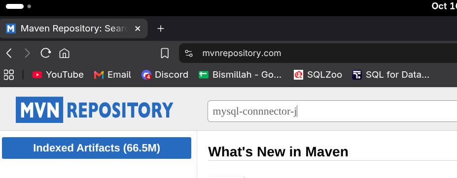
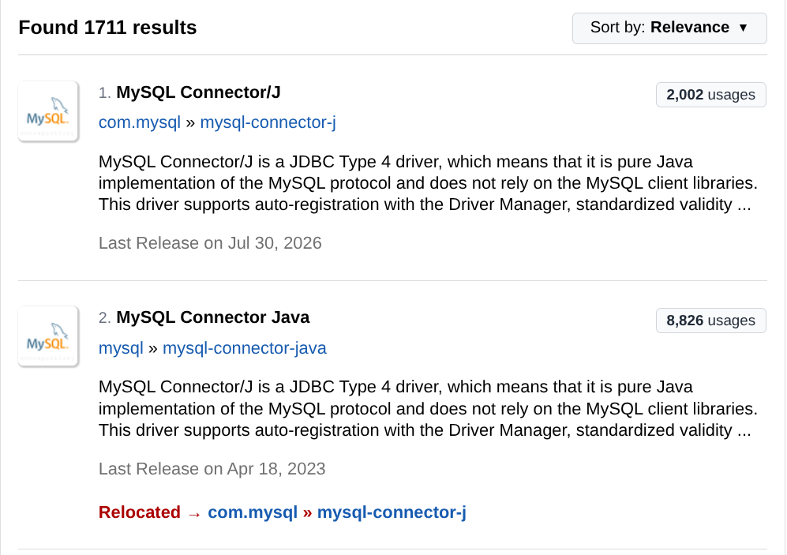
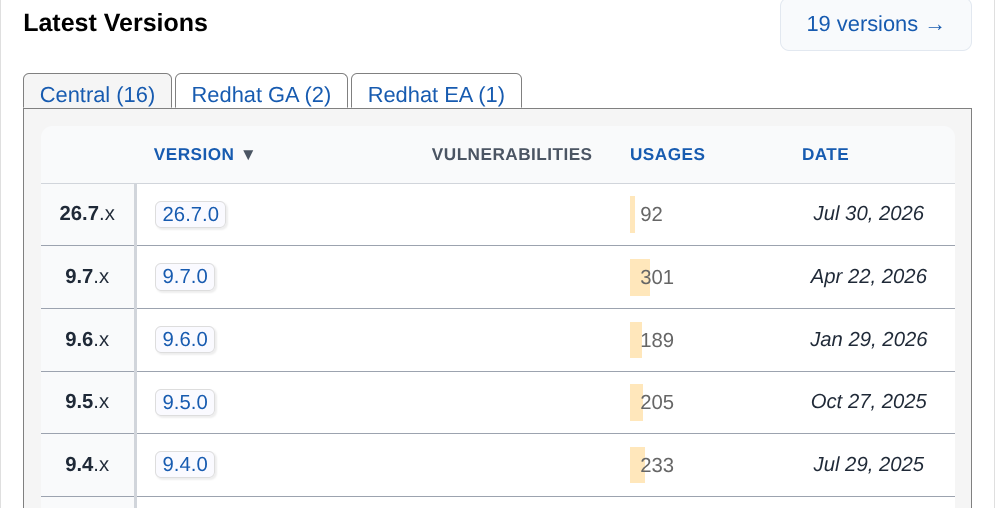
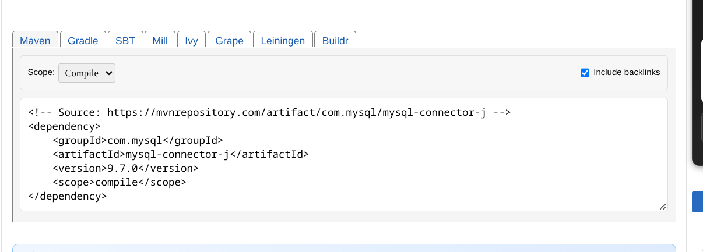
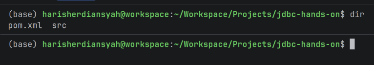
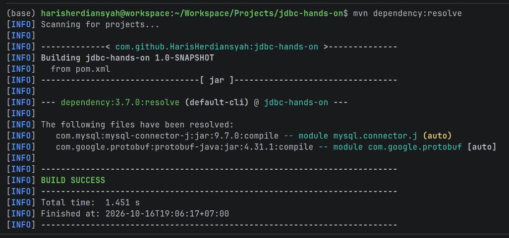

## Persiapan Database dan Environment
1) Tema dari program sederhana ini seperti tugas 7 dan latihan 8 yaitu course registration. Silahkan buat database terlebih dahulu dengan nama `course_registration` lalu salin ini di interface MySQL, DDL ini juga sudah tersimpan di `src/main/resources/schema.sql`. 
```sql
CREATE TABLE `students` (  
  `id` int PRIMARY KEY AUTO_INCREMENT,  
  `name` varchar(50) NOT NULL DEFAULT '',  
  `email` varchar(50) NOT NULL DEFAULT ''  
);  
  
CREATE TABLE `courses` (  
  `code` char(9) PRIMARY KEY,  
  `name` varchar(50) NOT NULL DEFAULT '',  
  `credits` int NOT NULL DEFAULT 1,  
  `class_capacity` int NOT NULL DEFAULT 1  
);  
  
CREATE TABLE `enrollments` (  
  `id` int PRIMARY KEY AUTO_INCREMENT,  
  `student_id` int NOT NULL,  
  `course_code` char(9) NOT NULL,  
  `enrolled_at` timestamp,  
  `status` ENUM ('ACTIVE', 'DROPPED') NOT NULL DEFAULT 'ACTIVE'  
);  
  
ALTER TABLE `enrollments` ADD FOREIGN KEY (`student_id`) REFERENCES `students` (`id`);  
ALTER TABLE `enrollments` ADD FOREIGN KEY (`course_code`) REFERENCES `courses` (`code`);
```

2) Setelah membuat tabel, silahkan isikan dulu nilai-nilai dari tabel.
```sql
INSERT INTO students (id, name, email) VALUES
	(1, 'Andi Pratama', 'andi.pratama@example.com'),
	(2, 'Budi Santoso', 'budi.santoso@example.com'),
	(3, 'Citra Lestari', 'citra.lestari@example.com'),
	(4, 'Dewi Anggraini', 'dewi.anggraini@example.com'),
	(5, 'Eka Saputra', 'eka.saputra@example.com'),
	(6, 'Fajar Ramadhan', 'fajar.ramadhan@example.com'),
	(7, 'Gita Maharani', 'gita.maharani@example.com'),
	(8, 'Hendra Wijaya', 'hendra.wijaya@example.com'),
	(9, 'Intan Permata', 'intan.permata@example.com'),
	(10, 'Joko Purnomo', 'joko.purnomo@example.com');

INSERT INTO courses (code, name, credits, class_capacity) VALUES
	('IF1010001', 'Pemrograman Dasar', 3, 30),
	('IF1020001', 'Struktur Data', 3, 30),
	('IF1030001', 'Basis Data', 3, 25),
	('IF1040001', 'Pemrograman Berorientasi Objek', 3, 25),
	('IF1050001', 'Rekayasa Perangkat Lunak', 3, 25),
	('IF1060001', 'Jaringan Komputer', 3, 30),
	('IF1070001', 'Sistem Operasi', 3, 30),
	('IF1080001', 'Kecerdasan Buatan', 3, 20);

INSERT INTO enrollments (id, student_id, course_code, enrolled_at, status) VALUES
	(1, 1, 'IF1010001', '2026-08-01 08:00:00', 'ACTIVE'),
	(2, 1, 'IF1020001', '2026-08-01 08:05:00', 'ACTIVE'),
	(3, 1, 'IF1030001', '2026-08-01 08:10:00', 'ACTIVE'),
	(4, 2, 'IF1010001', '2026-08-01 08:15:00', 'ACTIVE'),
	(5, 2, 'IF1040001', '2026-08-01 08:20:00', 'ACTIVE'),
	(6, 2, 'IF1060001', '2026-08-01 08:25:00', 'DROPPED'),
	(7, 3, 'IF1010001', '2026-08-02 09:00:00', 'ACTIVE'),
	(8, 3, 'IF1030001', '2026-08-02 09:05:00', 'ACTIVE'),
	(9, 3, 'IF1050001', '2026-08-02 09:10:00', 'ACTIVE'),
	(10, 4, 'IF1020001', '2026-08-02 09:15:00', 'ACTIVE'),
	(11, 4, 'IF1040001', '2026-08-02 09:20:00', 'ACTIVE'),
	(12, 5, 'IF1030001', '2026-08-03 10:00:00', 'ACTIVE'),
	(13, 5, 'IF1060001', '2026-08-03 10:05:00', 'ACTIVE'),
	(14, 6, 'IF1040001', '2026-08-03 10:10:00', 'ACTIVE'),
	(15, 6, 'IF1070001', '2026-08-03 10:15:00', 'ACTIVE'),
	(16, 7, 'IF1050001', '2026-08-04 11:00:00', 'ACTIVE'),
	(17, 7, 'IF1080001', '2026-08-04 11:05:00', 'ACTIVE'),
	(18, 8, 'IF1060001', '2026-08-04 11:10:00', 'ACTIVE'),
	(19, 9, 'IF1070001', '2026-08-05 13:00:00', 'DROPPED'),
	(20, 10, 'IF1080001', '2026-08-05 13:05:00', 'ACTIVE');
```

> Seperti yang dijelaskan sebelumnya, JDBC hanyalah kode bawaan Java yang berisi interface dan bukan implementasi atau kode program yang sudah jadi untuk dipakai. Kita memerlukan driver database yang berisi kode program yang mengimplementasi interface dari JDBC. Dalam kasus ini kita akan menggunakan `mysql-connnector-j` dan Maven sebagai pengelola kode eksternal.

3. Buka https://mvnrepository.com/ dan ketik mysql-connector-j lalu klik "Search"


4. Buka MySQL Connector/J, yang muncul di poin pertama bukan poin kedua


5. Scroll ke bawah sampai menemukan tampilan ini. Tampilan ini berisikan daftar driver dari berbagai versi yang bisa kita gunakan, pada contoh ini kita akan pakai `9.7.0`. Silahkan klik tulisan berwarna biru (atau kita sebut sebagai hyperlink) yang bertuliskan `9.7.0`.


6. Selanjutnya kamu akan dialihkan ke halaman baru, scroll ke bawah sampai menemukan tampilan ini. Tulisan-tulisan ini yang menyediakan sumber kode dari driver database yang kita butuhkan, silahkan salin semuanya. (Struktur ini mirip HTML, tapi ini disebut sebagai XML)


7. Buka file `pom.xml`, dan simpan didalam tag `<dependencies></dependencies>`. Tampilan akhirnya filenya seperti ini:
```xml
<?xml version="1.0" encoding="UTF-8"?>  
<project xmlns="http://maven.apache.org/POM/4.0.0"  
         xmlns:xsi="http://www.w3.org/2001/XMLSchema-instance"  
         xsi:schemaLocation="http://maven.apache.org/POM/4.0.0 http://maven.apache.org/xsd/maven-4.0.0.xsd">  
    <modelVersion>4.0.0</modelVersion>  
  
    <groupId>com.github.HarisHerdiansyah</groupId>  
    <artifactId>jdbc-hands-on</artifactId>  
    <version>1.0-SNAPSHOT</version>  
  
    <properties>       
	    <maven.compiler.source>21</maven.compiler.source>  
        <maven.compiler.target>21</maven.compiler.target>  
        <project.build.sourceEncoding>UTF-8</project.build.sourceEncoding>  
    </properties>
    
    <dependencies>       
        <dependency>  
            <groupId>com.mysql</groupId>  
            <artifactId>mysql-connector-j</artifactId>  
            <version>9.7.0</version>  
            <scope>compile</scope>  
        </dependency>    
    </dependencies>  
    

</project>
```

8. Buka terminal, pastikan kalian ada di direktori yang benar, tempat di mana `pom.xml` berada. Tapi bagaimana cara tahunya? Silahkan ketik `dir` di terminal (berlaku untuk Windows, Linux, dan MacOS)


9. Jika ada tulisan `pom.xml` artinya kalian ada di tempat yang tepat, jalankan `mvn dependency:resolve`, jangan sampai typo lalu tunggu hingga muncul "BUILD SUCCESS"


10. Selesai :D