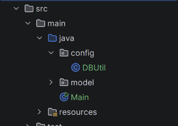

## Membuat Class Khusus Utilitas
Sangat repot jika setiap kali ingin membuka koneksi ke database, harus selalu memanggil `DriverManager` dan menyimpan kredensial database di mana-mana.

Buat package baru bernama `config`, lalu buat file Java baru bernama `DBUtil.java`. Pindahkan fungsi untuk membuka koneksi di sini.



```java
// DBUtil.java
package config;

import java.sql.DriverManager;
import java.sql.Connection;
import java.sql.SQLException;

public class DBUtil {
    private static final String jdbcUrl = "jdbc:mysql://localhost:3306/course_registration";
    private static final String jdbcUsername = "root";
    private static final String jdbcPassword = "yamabuki";

    public static Connection openConnection() throws SQLException {
        return DriverManager.getConnection(jdbcUrl, jdbcUsername, jdbcPassword);
    }
}
```
